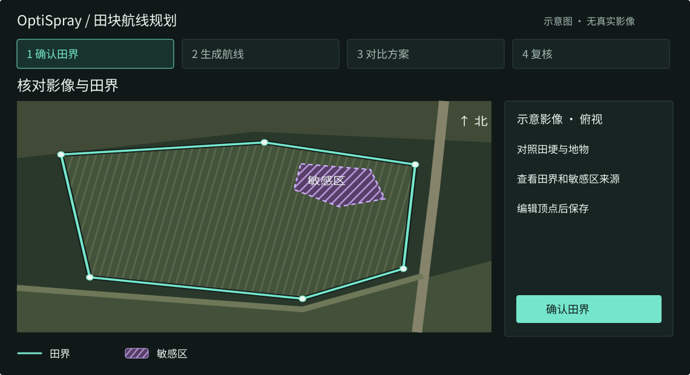
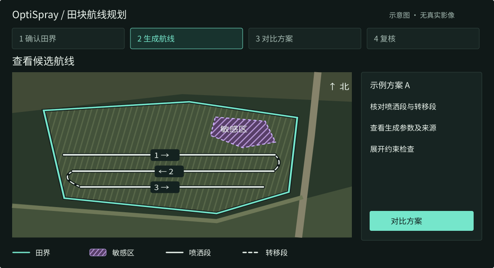
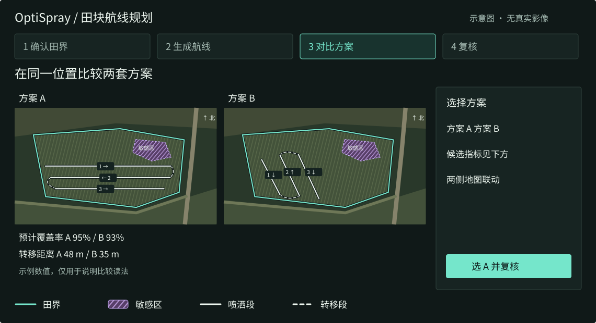
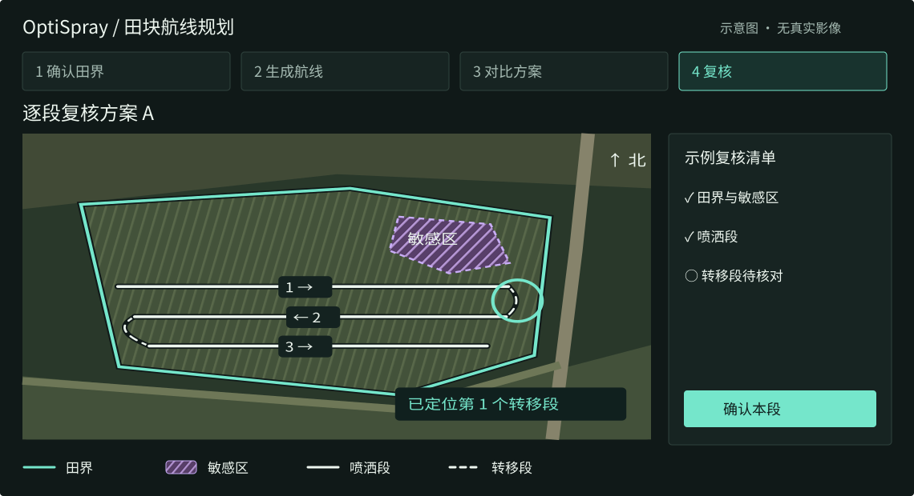
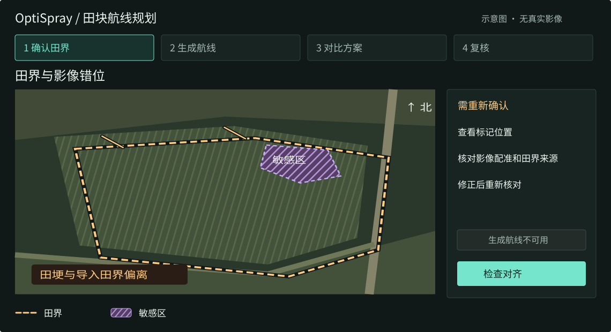

# OptiSpray 首个真实影像案例 · 田块航线规划

飞手打开同一田块的真实影像，独立确认田界和敏感区，在相同条件下比较至少两套候选方案，选定方案后逐段复核。平台保存飞手确认的地图、航线和报告依据。官网在案例通过验收、发布素材取得授权后，引用同一份结果做只读展示。

## 交互参考

| 参考 | 借鉴的动作 | 在本案例中的用法 |
| --- | --- | --- |
| DJI Terra 农业应用 | 在影像上核对识别结果，添加边界点和校准点，再生成路线；可切换路线显示和调整路线参数。 | 把影像对齐、田界确认和航线生成做成独立动作；影像或边界校核有疑问时直接定位。来源：[DJI Terra 官方指南](https://support.dji.com/help/content?customId=01700005201&lang=en&paperDocType=ARTICLE&re=CA&spaceId=17) |
| QGroundControl Survey | 在地图上拖动或插入多边形顶点，侧栏配置航线方向、入口和转弯。 | 地图与侧栏双向定位；显示喷洒段、转移段及顺序。方案对比和逐段确认是本案例的交互设计。来源：[QGroundControl 官方文档](https://docs.qgroundcontrol.com/Stable_V5.0/en/qgc-user-guide/plan_view/pattern_survey.html) |

## 飞手操作

设计以桌面作业台为首轮验收视口。顶部显示案例和当前步骤，地图为主区，侧栏显示所选对象、依据和下一动作。规划默认正北朝上的二维俯视。平台显示比例尺、缩放、回到田块和图层开关；地图点击与侧栏列表双向定位，关键对象可通过键盘列表选中。图中底图、路线和比较数字均为交互示意。

### 1. 确认田界

飞手查看案例标识、影像来源与采集日期，切换田界叠加或调节透明度，用田埂、道路交叉点等可辨识地物核对位置。点选田界顶点编辑，可撤销或取消。点选敏感区查看名称、来源、范围及约束口径。田界有效、配准检查通过、敏感区范围与来源已核对后，飞手点「确认田界」，平台保存当时的影像、田界和敏感区标识。未调查的敏感区显示「未知」。

### 2. 生成航线

侧栏并列显示平台可读取的约束、生成参数和来源。飞手点「生成航线」，等待状态显示「生成中」。成功后按候选方案查看航段编号、方向与约束检查；点击地图航段时侧栏显示段类型和喷洒开关。失败时保留已确认田界，给出原因和重试入口；候选不足两套时标出具体原因，暂不进入对比。参数改动后将之前的候选标为「需重新生成」。

### 3. 对比方案

方案 A 和方案 B 表示同一田块的两套候选。双地图联动平移、缩放，使用同一影像、方向、比例、图层和图例。两套方案共用气象快照和作业约束，侧栏列出不同的规划参数。两列指标按同一口径展示预计覆盖率、转移距离、预计作业时长和敏感区约束检查，标明单位、模型依据、差值和已知不确定度。预计覆盖率以同一已确认目标面积为分母，转移距离为所有非喷洒转移段的长度之和。模型缺项显示「不可用」与原因；存在阻断项的方案可查看原因，选定动作不可用。飞手选定方案并记录取舍理由。

### 4. 复核

侧栏清单依次列出田界与敏感区、喷洒段和转移段。选择条目后定位到地图对象，显示段号、飞行方向、喷洒开关以及与敏感区的检查结果。飞手逐段确认，有疑问时标为「待确认」并写明位置、原因。全部核对项完成且无阻断项后点「完成复核」。保存记录包含案例标识、影像和约束来源、田界标识、选定方案标识与参数、逐项结论、操作者和时间，并关联同一方案的报告。返回修改影像、田界或约束时，退回确认田界；修改规划参数时，退回生成航线。两种修改均使旧的复核结论失效，旧结果可追溯。

## 异常状态

| 状态 | 飞手看到的提示和可用操作 | 恢复条件 |
| --- | --- | --- |
| 影像缺失或加载失败 | 地图提示「影像不可用」，保留已有矢量和边界来源，支持重试或选回同案例的影像。确认田界不可用。 | 影像加载后重新核对来源、位置和田界。 |
| 田界错位 | 错位边界用琥珀虚线并标记检查位置；侧栏可定位、检查影像配准和田界来源。生成航线不可用。 | 修正配准或边界，重新执行位置检查并确认田界。 |
| 航段待确认 | 清单显示待确认段号、原因和定位入口。完成复核不可用。 | 飞手重新核对并确认该段；若需修改方案，重新生成并复核。 |

## 视觉与职责

| 要素 | 可复用的官网视觉 | 作业平台提供 |
| --- | --- | --- |
| 作业台外壳 | 石墨绿背景、青绿主操作、细边框、小圆角；参考官网 .hud-panel、.button、.button.primary 和键盘焦点样式。英文与数值用 Space Grotesk 和 IBM Plex Mono，中文采用可用的无衬线字体。 | 四步导航、状态文案、禁用原因、表单焦点与键盘操作。地图旁正文采用适合连续阅读的字号和高不透明度面板。 |
| 地图画面 | 延续 Three.js 场景的低饱和田地色和冷青强调，借用 .map-legend 与 .map-caption 的图例和读数外观。官网案例可用 Three.js 斜俯视做只读导览。 | 真实地理影像、坐标转换、北向与比例尺、图层开关、边界编辑、敏感区录入、选中定位和联动双地图。核对时用二维俯视，避免透视、雾化或滚动镜头遮住地物。 |
| 地图语义 | 官网案例沿用平台导出的图例和状态名称。 | 田界青绿实线带深色描边；敏感区紫色斜纹加虚线边；喷洒段白色实线加编号和箭头；转移段白色虚线加编号和方向，表示喷洒关闭。选中使用青绿外圈及文字，故障用琥珀色加明确提示。同一地图只显示一份图例；喷洒与转移线型是对平台现有「航线」图层的细化。 |
| 方案与报告 | 复用官网数据面板的层级与单位排版，展示通过验收且获准公开的字段和图片。 | 航线生成、段类型与约束检查、模型结果、候选排序和比较、复核记录、报告生成，以及公开素材的来源关联。 |

## 数据与验收

| 首例需要的数据 | 当前缺口与验收依据 |
| --- | --- |
| 可使用的真实正射影像 | 本轮可访问资料中未定位到首例影像或独立附件。需提供影像来源、采集日期、坐标参考系、分辨率、覆盖范围、配准验证点及允许偏差；官网发布另需使用授权。 |
| 实地田界和敏感区 | 需提供带坐标的边界与敏感区、采集来源、约束值及确认人。由案例负责人给出可接受的对齐误差；数据齐备前显示「待确认」。 |
| 生成与比较依据 | 需提供同一约束下至少两份候选及各自参数、航段类型和方向、模型版本、运行输入、指标口径与核查结果。现有演示数据只用于验证界面读法。 |
| 复核与报告 | 需确定首例飞手、试用数据、复核记录与报告标识，以及官网可展示的字段和影像范围。 |

以桌面平台与上述真实数据跑一遍，验收人旁观并记录操作与结论。以下各项均通过后，案例才可进入官网发布准备。

1. 飞手无需提示即可打开指定案例，用可辨识地物定位田块，核对影像来源、田界和敏感区后保存确认；定位结果符合预先约定的配准偏差。
2. 飞手能在正常地图和航段列表上指出田界、敏感区、喷洒段和转移段，解释转移段为何显示喷洒关闭，并用段号定位同一对象。
3. 飞手能用联动双地图找到至少一处方案差异，读出同口径的指标与约束结果，选择方案并记录一项取舍理由。用平台保存的结果核对指标、单位及方案标识。
4. 飞手逐段复核所选方案，未确认段可定位且阻止完成。完成后重新打开案例，仍能查到同一影像、田界、参数、航段结论和关联报告。
5. 分别模拟缺图、错位和航段待确认，确认动作按异常表阻断；恢复后重新完成相关核对。修改已确认输入后，旧复核失效。
6. 官网展示的航线图、结果与来源可由平台复核记录核对；影像授权、公开字段和脱敏范围有记录。

## 源码与设计来源

- 官网仓库在 D:/Workspace/conrad-optispray-website，基准提交 bf0683c。src/scene.js 提供 Three.js 镜头、雾和灯光，src/style.css 提供配色、字体、按钮、浮层和图例，index.html 提供场景和沉积读数面板。读取时官网没有本地改动。
- 作业平台仓库在 D:/Workspace/conrad project，基准提交 055c995。首例输入、平台验收和官网公开授权采用本地未跟踪的 docs/plans/website-platform-integration.md 所列口径。界面参考本地未跟踪的 app/web/operationMap/（OperationMap.tsx 的地图控件、model.ts 的航段与转移曲线、scene.ts 的图层、params.ts 的示例输入）、docs/style/map-grammar.md、docs/design/platform-tokens.md、tools/plan_optimizer.py、docs/reports/plan_candidates.json。地图和候选生成的这些来源用于识别现有演示能力，首例数据及复核记录待接入。
- 平台现存的已修改 app/web/pages/Monitor.tsx、app/web/styles.css、app/web/translations.ts 和 tools/build_aeroguard_field_fixture.py 用于核对作业台和证据夹具的边界。Monitor.tsx 通过 app/web/components/FieldMap.tsx 显示作业中地图，首例规划流程的接入入口待确定。现有本地文件保留原状。证据夹具面向模型与流体仿真配对，不能作为案例真实影像来源。
